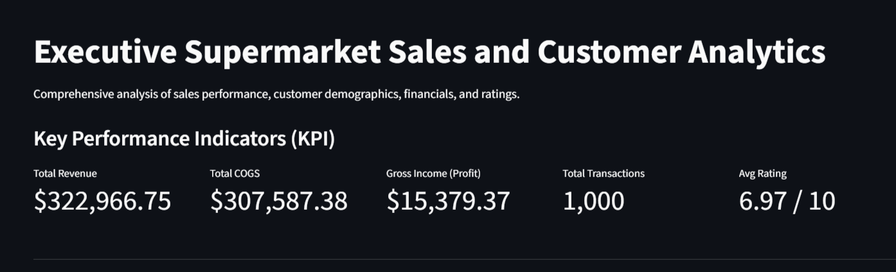
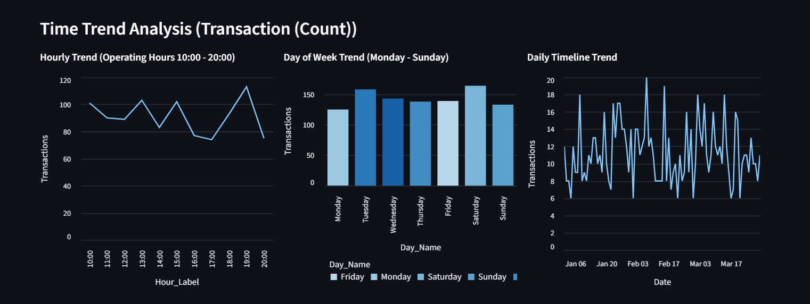
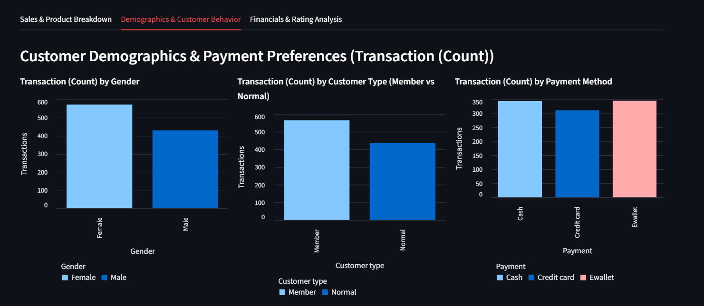
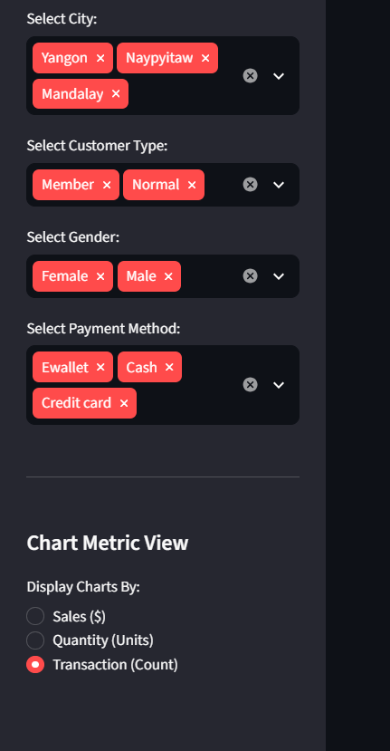

# Executive Supermarket Sales & Customer Analytics Dashboard

An interactive, multi-dimensional Business Intelligence dashboard built with Python and Streamlit to analyze supermarket transaction data, customer behavior, hourly peak traffic, and product profitability.

🔗 **Live Interactive Dashboard:** [https://dashboard-supermarket-7xrwudjfgvvkmghtzgawwr.streamlit.app/]

---

## Dashboard Preview

### 1. Key Performance Indicators & Product Sales

### 2. Time Series & Operating Hours Analysis

### 3. Customer Demographics & Payment Behavior

### 4. Dynamic Metric Switcher (Sales vs Units vs Transactions)

